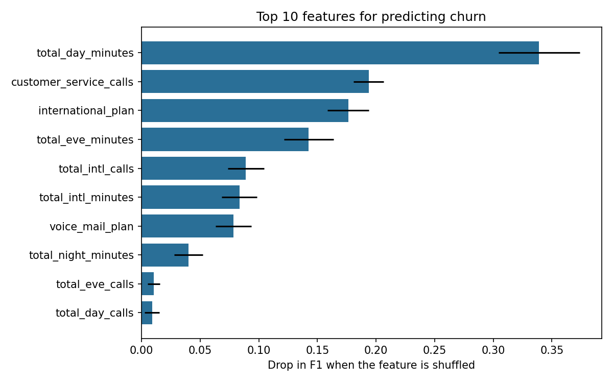

# Telecom Customer Churn Prediction

Predicting which telecom customers are likely to leave, so a retention team can contact them before they go, and finding out what drives churn.

## The problem

Winning a new customer costs far more than keeping an existing one. This project builds and compares classification models on customer account and usage data to (1) flag customers at risk of leaving and (2) identify the behaviours most linked to churn, so the business can act on them.

## Data

- **3,333 customers**, 20 features after dropping the phone number (account details, plan types, day, evening, night and international usage, and customer service calls).
- **Target:** `churn` (483 customers, **14.5%**, left; 2,850 stayed).
- Source: public telecom churn dataset. <!-- add the source name and link -->
- The classes are imbalanced: always predicting "stays" would already be **85.5% accurate**, so accuracy alone is a poor yardstick. I focus on precision, recall and F1 for the churn class.

## Approach

1. **Exploratory analysis:** churn rate by plan type, customer service calls, usage and state, plus correlations.
2. **Preparation:** dropped the unique phone number, encoded plans as 0/1, one-hot encoded state, stratified 75/25 train/test split (834 test customers, 121 of whom churned).
3. **First round of modeling:** compared logistic regression (baseline, SMOTE, tuned), a decision tree, a random forest and XGBoost.
4. **Second round (`churn_improvements.py`):** fixed weaknesses in the first round (see "What I changed").

## Results

Test set, churn class (121 churners out of 834 customers):

| Model | Accuracy | Precision | Recall |
|---|---|---|---|
| Logistic regression (baseline) | 0.65 | 0.26 | 0.81 |
| Logistic regression + SMOTE | 0.62 | 0.25 | 0.81 |
| Logistic regression (tuned) | 0.86 | 0.55 | 0.27 |
| Decision tree | 0.91 | 0.69 | 0.67 |
| Random forest (depth 5) | 0.88 | 0.91 | 0.17 |
| XGBoost (tuned on accuracy) | 0.94 | 0.88 | 0.72 |
| **XGBoost (tuned on F1), threshold 0.5** | **0.95** | **0.87** | **0.75** |
| **XGBoost (tuned on F1), threshold 0.3** | **0.95** | **0.84** | **0.79** |

- **Cross-validated F1 (churn class): 0.84** (5-fold, training data only).
- **ROC-AUC 0.90**, **PR-AUC 0.83** (a random model scores about 0.15).
- At threshold 0.3 the model catches **95 of the 121 churners**, and 84% of the customers it flags really do leave.

### Choosing a threshold

I chose the threshold using cross-validated predictions on the *training* data only, then evaluated on the test set once. F1 stays almost flat between thresholds of 0.25 and 0.50 (0.83 to 0.84), so the choice is a business decision: a lower threshold catches more churners but contacts more customers who would have stayed.

## What drives churn

Permutation importance on the final model (how much F1 drops when a feature is shuffled):

The top drivers match clear patterns in the raw data:

| Pattern | Churn rate |
|---|---|
| Customers **with an international plan** | **42.4%** (137 of 323) vs 11.5% without |
| Customers with **4 or more customer service calls** | **51.7%** (138 of 267) vs 11.3% with 0 to 3 |
| Customers using **more than 216 daytime minutes** (top quarter) | **29.3%** vs 6% to 12% in the other quarters |
| Customers **with a voicemail plan** | 8.7% vs 16.7% without |

The jump in service calls is sharp: churn is about 10% to 13% for 0 to 3 calls, then 46% at 4 calls.

These are associations in historical data, not proven causes.

## Recommendations

1. **Trigger a retention call after the 3rd customer service contact.** Churn jumps from about 10% to 46% at the 4th call.
2. **Review the international plan.** Its customers churn at almost four times the rate of others, which suggests a pricing or quality problem worth investigating.
3. **Review pricing for heavy daytime users.** Churn is much higher above about 216 minutes a month.
4. **Rank customers by predicted churn risk** and direct retention offers to the top of the list, using the threshold that fits the retention budget.

## What I changed after the first version

- **Tuned for F1 instead of accuracy,** because accuracy rewards ignoring the minority class.
- **Added 5-fold cross-validation,** because the test set holds only 121 churners.
- **Selected the threshold on training data only,** so the test set was used once.
- **Dropped the four charge columns,** which are just minutes times a fixed rate, so importance is not split across duplicates.
- **Added permutation importance** for the final model.
- **Replaced unsupported claims** (such as network coverage by state) with findings the data supports.

## Limitations

- **Small test set:** 121 churners means the metrics carry noticeable uncertainty.
- **Overfitting gap:** the first tuned XGBoost scored 97.6% accuracy on training data against 94.5% on test data.
- **State-level patterns** rest on about 65 customers per state, so I did not draw conclusions from them.
- **Associations, not causes:** the data cannot show why customers leave.
- **No deployment:** the model is evaluated offline and has not been tested on new customers over time.

## Repository contents

| File | Purpose |
|---|---|
| `Phase_3_project.ipynb` | First-round analysis and modeling |
| `churn_improvements.py` | Second-round evaluation: F1 tuning, cross-validation, threshold selection, feature importance |
| `churn_results.txt` | Output of `churn_improvements.py` |
| `feature_importance.png` | Feature importance chart |
| `Non-technical/` | Summary for a non-technical audience |

To reproduce: `pip install xgboost pandas scikit-learn matplotlib`, then `python churn_improvements.py`.

## Tech stack

Python, pandas, NumPy, scikit-learn, XGBoost, matplotlib

## Author

David Kamiti | [GitHub](https://github.com/Davidkamiti)
